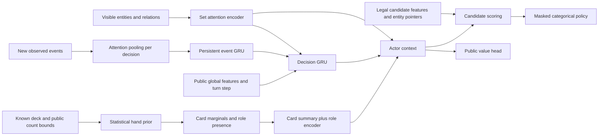

# Search-free entity, history, and statistical-role policy

This redesign is a research-informed starting architecture for two-player constructed Magic with announced deck lists. It implements the model, recurrent PPO learner, inference service, synchronous self-play runner, and an XMage source adapter. Playing strength has not been established. No paper establishes an ideal MTG architecture; the choices below need controlled comparisons.

The current default uses a deterministic known-deck prior and 20 overlapping role-presence features. The earlier learned hand head is preserved only in `belief_mode: learned` for compatible checkpoints and comparisons. [Current implementation, reproduction, and measured validation](statistical-roles-implementation.md) and [the research behind this change](statistical-belief-and-card-roles.md) give the details.

## Research and the resulting choices

| Primary source | Relevant finding | What this implementation takes |
|---|---|---|
| [AlphaStar, Nature 2019](https://www.nature.com/articles/s41586-019-1724-z), [authors' architecture overview](https://deepmind.google/blog/alphastar-mastering-the-real-time-strategy-game-starcraft-ii/), [released architecture code](https://github.com/google-deepmind/alphastar/blob/main/alphastar/architectures/README.md) | Entity processing, recurrent memory, structured action selection, and a league can address a large partially observed game. | Attention over game objects, persistent history, entity pointers in actions, and a small historical opponent pool. A GRU replaces the much larger recurrent system for local compute. |
| [DouZero, ICML 2021](https://arxiv.org/abs/2106.06135) | Deep Monte Carlo learns action values from completed games with action representations. | Explicit representations of legal candidate actions and terminal game outcomes. Deep Monte Carlo is a return estimator, distinct from Monte Carlo tree search. |
| [DouZero+, CoG 2022](https://arxiv.org/html/2204.02558) | Predicting opponents' per-card counts from historical play can improve decision inputs; the predictor learns from actual hidden cards available during training. | The earlier experimental hand-count predictor remains available for comparison. The new default supplies known-deck statistics and role-presence probabilities while retaining history in the actor. The coach's opening rejection scheme is omitted. |
| [PerfectDou, NeurIPS 2022](https://arxiv.org/html/2203.16406) | A privileged training critic can accompany an incomplete-information actor and PPO-based learning. | A separate critic sees the true opponent hand during learning. It receives detached actor context, so critic-only private inputs cannot backpropagate into actor representations. This is a limited privileged critic, not a complete replication of PerfectDou's critic or training system. |
| [DeepNash, Science 2022](https://arxiv.org/html/2206.15378) | An imperfect-information game can be learned without strategic search using regularized policy learning. | Motivation for retaining a stochastic direct policy. DeepNash does not use an explicit belief model. Its R-NaD algorithm and equilibrium guarantees are not implemented or claimed for PPO. |
| [PPO](https://arxiv.org/abs/1707.06347), [GAE](https://arxiv.org/abs/1506.02438) | Clipped policy updates and advantage estimates offer a practical actor-critic learner. | Synchronous recurrent PPO, terminal rewards, and GAE. |

These results support the components, not a claim that this combination beats the original MageZero. DouZero's value-based learner remains a useful alternative experiment. PPO was selected here because one variable legal-action scorer can cover priority, targets, combat, modes, and binary choices while supporting a stochastic policy.

## Actor



The actor consumes only information available to its player. An observation contains visible cards/permanents, both public player states, stack objects, visible exile, permitted card choices, and aggregate hidden-zone sizes. Ownership, controller, kind, and zone have separate embeddings. Dynamic features include power, toughness, damage, counters, tapping, combat status, life, and mana. Directed relations encode attachments, stack targets, attackers' defenders, and blocker assignments.

Card identity uses a fixed catalog shared with XMage. ID 0 means unknown/hidden/padding; actual cards have stable positive IDs. Each card combines a learned embedding with 32 numeric semantics covering types, color, cost, power/toughness, and common keywords. This is deliberately a finite deck-pool vocabulary. It is not an Oracle-text language model and has no demonstrated generalization to unseen cards.

Entity attention has no positional encoding: reordering a set does not change its meaning. Relation messages are averaged per entity, so a defender attacked by twenty tokens keeps its own features. The pre-norm encoder ends with a LayerNorm. A learned pooling token produces global context, while contextual entity vectors remain available to candidate pointers. The pooled entities enter the actor context directly as well as through the decision GRU. Padding and legal-action masks are explicit; oversized observations fail rather than silently dropping objects or legal moves.

The new events since the previous decision are pooled into one vector with multi-head attention from a learned query (a set-transformer PMA block, linear in the number of events). Order inside a decision enters through a recency embedding (log2 distance from the newest event) and the count through a log feature. The event GRU then takes one step per decision that has new events, so a Kinnan loop of thousands of events costs one recurrent step instead of thousands of steps of backpropagation through time. A separate decision GRU combines event memory, the current entity summary, and public global features. The turn step (`globals[9]`, an enum ordinal) is also given to the global encoder one-hot, and the global state is layer-normalized to the scale of the other two inputs. Memory belongs to a `(game_id, player_id)` session and resets at game boundaries. The adapter records draw, cast, activation, zone changes, combat, damage, life, shuffle, passes, and the observer's previous choices. Opponent draws carry no card identity. Publicly revealed information may enter history; generic reveal and resolution coverage still need expansion in the Java adapter.

Every decision supplies a variable list of legal candidates. Candidates combine action type, numeric features, card identity, contextual source/target pointers, and simple lexical bins for named choices/modes/rules. One scorer outputs one logit per candidate, rather than fixed 128-action heads. Sequential choices factor large target/combat decisions into smaller decisions. Lexical bins are an economical initial representation; a richer ability vocabulary or text encoder is a future ablation.

The public value head is a training prediction. The policy selects an action directly from the categorical distribution; it does not use values for planning or simulate futures.

## Belief over the known opponent deck

The default uses a hypergeometric prior. Public lower bounds represent known copies in hand; subtract them from the upper bounds and hand size to obtain the unknown pool and unknown slots. Card-count marginals are calculated in closed form. For a category with `R` qualifying copies in an unknown pool of `N` cards and `m` unknown hand slots, probability of at least one is `1 - choose(N-R,m)/choose(N,m)`, or one when a qualifying hand card is already known.

Twenty reviewed overlapping roles supply twenty presence probabilities, passed through a linear encoder with SiLU and added to the existing card summary. Card identities, expected card counts, per-card presence, and marginal entropy remain available. There is no role softmax: a card can provide more than one capability. Role presence denotes possession under the prior, not affordability or suitability against a particular target. Catalog metadata must explicitly annotate every card; the supplied reviews cover simplegreen and selected example cards.

This removes the learned count head and count DP from default inference. The prior does not account for strategic retention, mulligans, or private selection. Persistent history remains in the actor. A learned residual and context-dependent role queries are future comparisons, not default features.

### Earlier learned-belief variant

Let `n_i` be the number of copies of card kind `i` in the opponent's hand, `h` its public hand size, and `[l_i,u_i]` public count bounds. The recurrent context predicts count scores `s_i(c)`:

```text
p(n | observation history) = exp(sum_i s_i(n_i)) / Z
subject to l_i <= n_i <= u_i and sum_i n_i = h.
```

Log-space dynamic programming computes `Z` and exact marginals of this specified model. This is arithmetic over hand counts, not game-tree search or hidden-state rollouts. The expected counts sum to `h`; impossible counts have zero mass. The current factorization represents correlations induced by the constraints, but not every strategic correlation between card types.

The actor receives expected counts, per-card presence probabilities, and marginal entropy. It does not sample a guessed hand or treat the largest-probability hand as fact. During training the joint negative log likelihood uses actual opponent hand counts, saved separately from observations. Private labels enter only the completion endpoint after action selection.

The Java adapter derives upper bounds from the announced deck minus original cards visibly outside the hand/library. It conservatively tracks lower bounds for cards publicly returned to hand. Hidden departures remove certainty rather than identifying which hidden card left. The Python protocol supports richer public bounds, but the initial adapter is not a complete visibility/knowledge tracker for every Magic mechanic.

Generated, copied, stolen, or transformed cards outside the declared candidate catalog require an extended public candidate/count tracker. The adapter explicitly rejects unsupported off-deck hand labels instead of using their private identities to expand the actor's candidates. Deck-pool coverage must be established before long training.

## Learning and collection

The default training objective is clipped PPO plus a privileged critic loss, public value regression, and policy entropy. With `auxiliary_belief: true` (the default in `configs/policy.yml` for new checkpoints), a separate head predicts opponent hand counts from the decision memory, scored with the exact count model above and trained with weight `belief_coefficient`. Its prediction never enters the actor's context, logits or value; it only shapes the recurrent representation, as in DouZero+/Suphx-style auxiliary targets. Whether it helps play is an open ablation. Without it, statistical hand NLL is diagnostic only. The earlier `learned` variant instead feeds its trained belief to the actor. The true hand is visible to the critic and training/evaluation targets only; private labels are absent from actor inference inputs.

Trajectories follow one player's consecutive decisions, including multiple decisions in one turn. Game rewards are terminal win `+1`, loss `-1`, or real draw `0`; `training.shaping_coefficient` adds potential-based shaping from the observer's public state (`shaping.py`), which changes value targets but not the optimal policy. There is no alternating-player sign flip and no MCTS visit/value target. `gamma=1` avoids discounting a player simply for making more micro-decisions; `gae_lambda` (0.95 in `configs/policy-final.yml`, 0.97 by default) trades bias and variance.

The entropy bonus divides each decision's entropy by the log of its number of legal candidates, so binary choices and 256-option amounts get comparable exploration pressure. Gradients are clipped separately for the actor (with its public value head) and the privileged critic. A minibatch whose approximate KL from the behaviour policy exceeds 1.5 × `target_kl` ends the update before its optimizer step. A behaviour-cloned start bootstrapped with `gae_lambda < 1` must use the shaping coefficient and gamma its value heads were cloned with; the learner refuses otherwise.

Collection freezes a checkpoint until games finish. The learner rejects a stale policy version and recomputes behavior probabilities to catch mismatched weights, history, or candidate ordering. Every PPO pass reconstructs recurrent memory from step zero at current weights. Each chunk of `sequence_length` decisions (default 32) is collated once per update. Window *w* stacks chunk *w* of every trajectory in the minibatch into one forward pass (`forward_episodes`): the entity encoder, belief and action scorer run over all rows together, and each GRU runs once over padded, packed per-trajectory sequences. `episodes_per_batch` therefore sets both the optimizer minibatch and the GPU batch width. Memory is detached between chunks (truncated BPTT); optimizer updates happen only after whole episode minibatches, avoiding memory carried across a weight change. Both the single-trajectory and multi-trajectory paths are tested to match step-by-step inference.

The engine resolves decisions with a single legal action without calling the policy; the choice still enters the history stream and reaches the actor with its next observation. Policy loss, entropy, KL early stopping and advantage normalization use only decisions with alternatives, so any recorded forced steps (older data) no longer dilute them; value losses still use every step.

Games stopped by the turn limit without a rules-engine error are recorded as **truncated** trajectories (`truncated: true`, zero rewards, full labels). The learner bootstraps them: no observation follows the last recorded decision, so that decision's own critic value is the bootstrap estimate and its advantage is zero; earlier decisions receive ordinary GAE into critic values. They are never scored as draws. Rules-engine errors (which XMage swallows in test mode and ends the game) and wall-clock timeouts are discarded, counted, and reported per generation (`games`, `failure_fraction`, `truncation_fraction` in `metrics.json`).

Self-play alternates current-policy games and historical opponents. Odd-numbered games swap the two controllers between seats, so against a fixed opponent the learner plays both decks of an asymmetric matchup; the starting player alternates independently. Smoothed prioritized fictitious self-play sampling favors opponents with low observed learner win rates, with a uniform component for coverage. This is a small snapshot pool, not AlphaStar's full league, exploiters, population training, or a convergence guarantee.

Collection runs up to 16 XMage games concurrently (`--engine-threads`). The policy service batches decisions that arrive together (see the protocol). Both sides of collection persist across generations: `PolicyGames --serve` keeps one JVM (card database, card scan, warmed JIT) and plays one batch per request, and policy services stay up and swap checkpoints through an opt-in `/reload` between batches. `--actor-shards N` runs N service processes per checkpoint; the engine routes game g to shard g mod N for both of its players, sidestepping the per-process GIL.

Measured on 32-game simplegreen generations (16 engine threads, this machine): collection fell from 26.6 s (fresh JVM and services, unbatched) to 17 s with batching, and to 5.3–6.3 s once warm — essentially game play time. The one-time JVM boot (~7.5 s) is paid in the first generation only. A second shard saves about 15% of play time (`--actor-shards 2 --actor-threads 2`); more shards add little because the 16 game threads and the services then compete for the same CPU cores.

Asynchronous off-policy actors would require a corrected learner such as [IMPALA/V-trace](https://arxiv.org/abs/1802.01561), or tightly controlled actor lag. The current runner intentionally stays synchronous rather than feeding stale data into PPO.

## Local compute and validation

The detected computer has an RTX 5070 with about 12 GB VRAM, 31 GB RAM, and 16 logical CPU threads. The default is width 256, two attention layers, four heads, and two width-256 GRUs. With the 174-card Commander catalog the statistical-role actor has 4,784,642 parameters (checkpoint format 4; format 2/3 weights do not load and need `mz init`). Limits are configurable; 64 hand-count classes plus zero, 512 entities, 2,048 actions, and 1,024 incremental events (8,192 for Commander) are starting limits, not Magic rules.

The latest matched synthetic benchmark, PyTorch `2.11.0+cu130`, used 64 entities, 32 actions, 24 opponent card kinds, and hand size seven. Across 50 warmed samples, CPU medians were **7.29 ms learned / 4.72 ms statistical**, and CUDA medians **66.97 ms learned / 20.54 ms statistical**. These exclude encoding, HTTP, and Java and are not a playing-strength comparison. Live inference defaults to CPU. On 750 recorded simplegreen decisions (one epoch), the batched learner measured 170 decisions/s on CPU and 360–450 decisions/s on CUDA, against 59/s for the earlier serial CPU learner, so `train`/`selfplay` default the learner to `auto` (CUDA when present). See [the implementation report](statistical-roles-implementation.md) for workload and device-test scope.

All 10 regression tests passed on this computer. They cover exact belief marginals against exhaustive small-hand enumeration, finite gradients, padding, entity/candidate reordering, recurrent resets, hidden-input rejection, isolated critic gradients, terminal/truncated GAE, idempotent HTTP sessions, checkpoint reloads, CPU/CUDA PPO updates, and stale-data checks. A real XMage rules game with synthetic cards completed over HTTP and yielded two trajectories totaling 316 decisions. The complete 35-module distribution then built, and two games using the fork's real `simplegreen` deck completed through the packaged self-play launcher: four trajectories, 1,172 decisions, and an updated CUDA-trained checkpoint. This validates the core loop and that deck's exercised mechanics, not arbitrary cards or playing strength. [Raw validation metrics](validation.json) and [XMage integration](xmage-integration.md) describe scope and reproduction.

## Experiments needed before choosing a stronger architecture

Use fixed deck matchups, swapped seats, multiple training seeds, and held-out opponent snapshots. Report terminal win/draw rates with confidence intervals, timeout/error rates, games/hour, decision latency, peak VRAM, and belief joint NLL/count error/calibration. Compare at both equal wall time and equal game count.

| Comparison | What it tests |
|---|---|
| Entities versus an information-matched sparse encoder | Representation quality without hidden-hand differences |
| Recurrent memory versus current snapshot only | Value of observed play history |
| Belief fed into actor versus auxiliary loss only versus no belief | Whether explicit hidden-card prediction helps decisions |
| Public critic versus privileged hand critic | Training benefit of privileged information |
| Current self-play versus historical pool | Robustness and forgetting |
| Width 128/256 and one/two attention layers | Strength per unit compute |
| Fixed bounds versus richer public knowledge tracker | Benefit of correctly tracking reveals and generated cards |
| Direct PPO versus DouZero-style action-value learning | Learning algorithm sensitivity |

An old MCTS baseline must have the same legitimate observation information and be evaluated at a stated compute budget. The original configurations expose the opponent hand in some paths, so an uncorrected baseline would not be a valid partial-information comparison. R-NaD, richer belief families, rule-text pretraining, and batched actor inference are later experiments, not implemented features.
