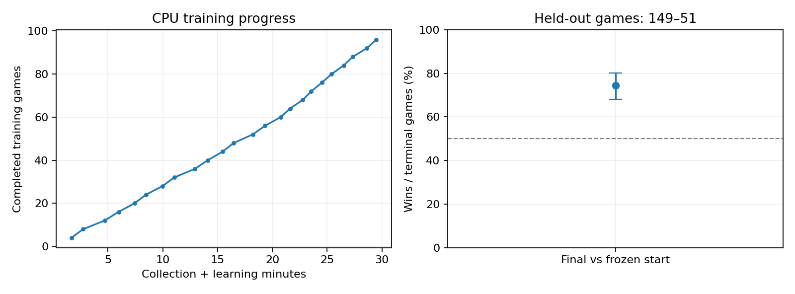
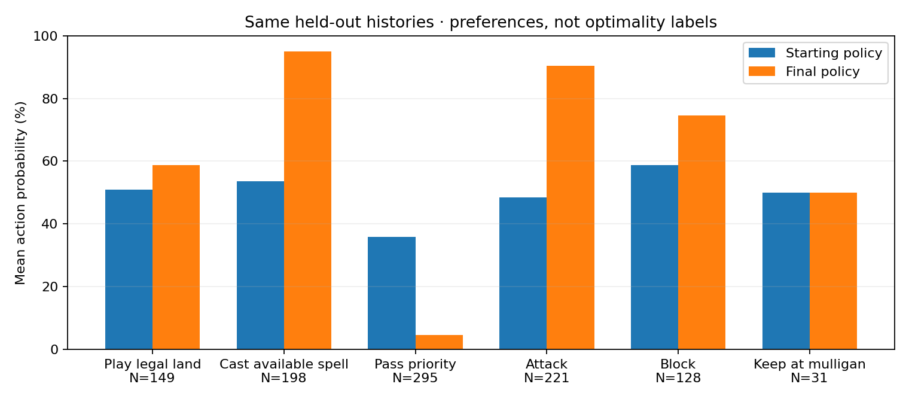

# Thirty-minute CPU training: strategy evaluation

**The final agent improved over the frozen starting policy on the simplegreen mirror matchup.** It won **149 of 200 fresh games (74.5%)**, with 51 losses, no draws, and no errors or truncations. This is evidence of learning basic play against this baseline, not evidence of general Magic strength or superiority over a trained upstream MageZero agent.

## What trained

Training continued from the one-update statistical-role smoke checkpoint, `artifacts/statistical-roles-smoke/generation_0000/policy.pt`. Both actor inference and learning used CPU, with one Torch/BLAS thread per Python process. The engine collected four games per generation with two Java workers.

| Training quantity | Measured value |
|---|---:|
| Wall time | 1,770.4 s — 29 min 30 s |
| Completed generations | 24 |
| Completed games | 96 |
| Recorded observer decisions | 29,473 |
| Loss-bearing PPO decision passes | 58,946 |
| Optimizer steps | 72 |
| Collection time, summed | 710.6 s |
| Learning time, summed | 1,051.7 s |
| Learning passes/s, aggregate | 56.0 |

The budget controller stopped between complete generations using recent measured durations. It did not interrupt an update or relabel partial games as draws. Historical opponents' observer trajectories were excluded from training. Current-policy self-play supplied both observers; historical matches supplied only the learner's observer.

Configuration: [`policy-cpu-30min.yml`](../configs/policy-cpu-30min.yml), two PPO epochs, episodes/minibatch four, TBPTT length 32, learning rate 0.0003, gamma one, and GAE lambda one. Lambda one supplies full terminal-return credit across the many micro-decisions. It differs from the earlier smoke's lambda 0.97, so this experiment evaluates the continued training procedure rather than isolating the architecture change.

Statistical hand/category probabilities have no trainable prediction head and zero belief-loss weight. The policy learned how to use its observations, history and probability features. A changing hand NLL across different games would not constitute belief-head learning.

The final checkpoint is [`policy.pt`](../artifacts/statistical-cpu-30min-20261012/generation_0023/policy.pt), with 25 lifetime updates including its initial smoke update. The original starting checkpoint remains available.

## Held-out playing strength

The [evaluation plan](cpu-30min-evaluation-plan.md) specified 200 games against the frozen starting policy, balanced across starting seats. Neither the model nor the final-checkpoint selection used evaluation outcomes. The agent sampled from its policy during evaluation, as in self-play.

Two disjoint seed blocks completed: 24 recorded games at base seed 20261030 (14–10) and 176 additional games at base seed 20261130 (135–41). Different outcomes between the small first block and larger second block illustrate why the first result alone was insufficient.

| Final policy's seat | Wins | Losses |
|---|---:|---:|
| Starts | 77 | 23 |
| Second | 72 | 28 |
| Total | **149** | **51** |

The descriptive Wilson 95% win-rate interval is **68.0%–80.0%**. Resampling the **100 swapped-seat seed pairs** gives a percentile bootstrap 95% score interval of **68.5%–80.5%**. There were no draws, so score and win rate coincide. Both intervals are above 50%, and there is no observed failure-exclusion bias. This meets the predeclared evidence criterion for improvement on this matchup.

Paired seeds do not guarantee identical card UUID ordering or sampled action streams. Bootstrap inference assumes independence between seed pairs; it is an uncertainty estimate for this test, not a universal guarantee. There is only one training run, one deck matchup, and one frozen comparison opponent. The starting policy was close to uniform on many choices, so defeating it does not establish competitive strength.

## What changed in its strategy

Both checkpoints replayed **the same 16 held-out observer histories**, eight from each agent's recorded stream, rebuilding memory from step zero. The sample contained **3,611 observations and 726 decisions with alternatives**. Forced decisions were excluded from action-preference summaries. Evaluation trajectory IDs were checked against training IDs and were disjoint.

| Choice, conditional on the recorded opportunity | States | Starting probability | Final probability |
|---|---:|---:|---:|
| Play a legal land from hand | 149 | 51.0% | 58.8% |
| Cast when a spell is available | 198 | 53.7% | 95.1% |
| Pass at a priority choice | 295 | 35.9% | 4.5% |
| Attack when legal | 221 | 48.5% | 90.4% |
| Block when legal | 128 | 58.7% | 74.7% |
| Attack with positive power and no opposing creatures | 33 | 48.4% | 88.7% |
| Keep at a mulligan choice | 31 | 50.0% | 50.0% |

These are average probabilities on identical observations, not actual action frequencies or optimal-action labels. Rows use different conditions and overlapping opportunities, so their percentages do not sum to 100%. Observations within a game are correlated. More attacking or blocking is not universally better.

The clearest learned pattern is much more active deployment and combat: the agent usually casts available creature spells, passes far less often when it has alternatives, and attacks more consistently. The increase in attacks into a board with no opposing creatures is consistent with better basic offensive play. The head-to-head results separately establish a net performance benefit against this baseline. This does not identify which behavior change caused the gain or show that all the extra attacks/blocks are correct.

The fixed-history KL divergence at choice states was 0.848 nats, confirming a substantial change in the action distribution rather than a checkpoint-only change. Early training looked worse: one initial replay showed reduced casting, and the first historical batches lost every game. Later training recovered. Those provisional results were not used to select a different final checkpoint.

## Remaining weakness and next experiment

Mulligan choices did not meaningfully improve in this sample. Keep probability stayed about 50% for normal land counts, one-land hands and the single observed zero-land large hand. The rare-hand buckets are too small for general claims.

An input audit confirmed that the two mulligan alternatives share action type and card/pointer inputs, with their first numeric argument only differing between **0 and 0.015625**. This weak choice contrast is a plausible bottleneck, alongside sparse mulligan training opportunities; this test does not prove the causal contribution of either. Explicit semantic keep/mulligan features are a small, focused next change. No action encoding was changed during this run or its evaluation.

Before claiming broader strength, evaluate additional fixed opponents and several reviewed deck matchups, including interaction-heavy decks. The simplegreen pool cannot test counterspell bluffing, removal timing, or the usefulness of every role category. An ablation is needed to isolate any advantage from role summaries, statistical priors, history or the lambda-one training setting.

## Artifacts and reproducibility

- [Aggregate measurements and provenance](cpu-training-2026-10-12.json)
- [Training configuration](../configs/policy-cpu-30min.yml)
- [Evaluation plan](cpu-30min-evaluation-plan.md)
- [Arena block 1 results](../artifacts/statistical-cpu-30min-eval-recorded/results.json)
- [Arena block 2 results](../artifacts/statistical-cpu-30min-eval-main/results.json)
- [Same-history behavior measurements](../artifacts/statistical-cpu-30min-20261012/heldout-behavior.json)

The implementation/evaluation test suite passed **22 checks**. CPU training and both arena jobs exited successfully and their local policy servers were closed. No background training remains.
