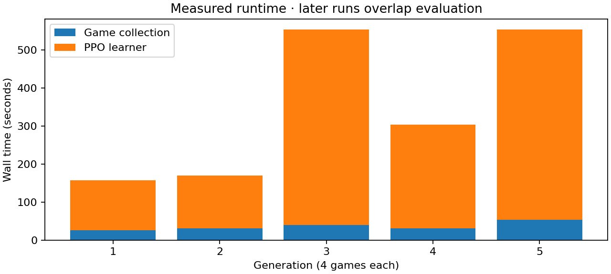
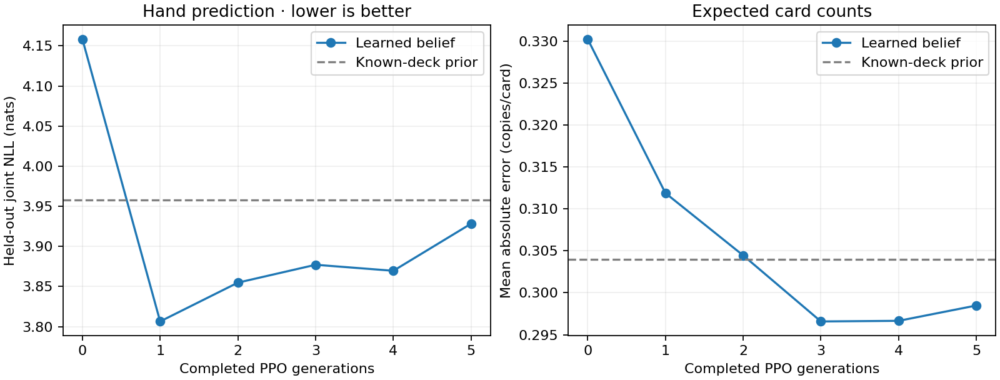

# Measured training pilot — 12 October 2026

The belief predictor learned some useful statistical structure. This pilot did **not demonstrate stronger play**, and it cannot establish an improvement over a trained upstream MageZero neural agent.

## What ran

Five generations of four `simplegreen` mirror games completed on the local machine: **20 games, 8,180 recorded decisions, 16,360 loss-bearing PPO decision passes, and 16 optimizer steps**. Summed generation time was **1,737 seconds (28 minutes 57 seconds)**. Each generation used two PPO epochs, sequence length 32, four episodes per optimizer minibatch, CPU actors, and a CUDA learner. Initialization seed was 20261012; the collector's game seeds were stochastic. Generations alternated current-policy self-play and historical opponents. Historical opponents' trajectories were not used for learning.

The final checkpoint is [`policy.pt`](../artifacts/pilot-2026-10-12-extension/generation_0002/policy.pt). Configurations are [`policy-pilot.yml`](../configs/policy-pilot.yml) and [`pilot-game.yml`](../configs/pilot-game.yml). Full measurements and provenance are in [`pilot-2026-10-12.json`](pilot-2026-10-12.json). No long-running training process remains.

## Speed

| Generation | Collected decisions | Collection | PPO learning | Loss-bearing passes/s |
|---|---:|---:|---:|---:|
| 1 | 1,691 | 25.5 s | 131.2 s | 25.8 |
| 2 | 909 | 31.1 s | 138.5 s | 13.1 |
| 3 | 2,233 | 39.9 s | 513.1 s | 8.7 |
| 4 | 1,046 | 30.5 s | 272.8 s | 7.7 |
| 5 | 2,301 | 53.7 s | 499.5 s | 9.2 |

Collection rates exclude learning and should not be confused with end-to-end throughput. Later runs overlap baseline/evaluation work, so the slowdown cannot be attributed solely to model learning or one hardware component. The first four-game generation took about 157 seconds end to end. Across the pilot the PPO learner dominated runtime.

A matched learner microbenchmark used the same complete 178-decision episode, the same initial checkpoint, one epoch, sequence length 32, and one CPU thread. It included checkpoint loading/saving, baseline replay, forward and backward work:

| Device | Wall time | Loss-bearing passes/s |
|---|---:|---:|
| CPU | 6.09 s | 29.25 |
| RTX 5070 / CUDA | 21.93 s | 8.12 |

CPU was about **3.6 times faster for that episode and this implementation**. Peak CUDA allocation was about 122 MB. The learner currently forwards one observer decision at a time; an episode minibatch of four accumulates gradients serially rather than using a true four-row model batch. Small sequential operations, tensor transfers, and count-DP kernels are plausible bottlenecks. This is not evidence that GPU learning is inherently worse, and the one-episode result is not a universal throughput ratio. Until the learner is batched and remeasured, `--device cpu` is a sensible follow-up on this machine.

## Is it learning?

Evaluation reused four observer trajectories from **two earlier games**, entirely excluded from this pilot's training. Each checkpoint replays the complete observed history from step zero. These are 1,172 correlated states, not 1,172 independent test games.

| Held-out metric; lower is better | Initial | Final | Public known-deck prior |
|---|---:|---:|---:|
| Joint hand-count NLL | 4.158 | 3.928 | 3.958 |
| Expected-count MAE, copies/card | 0.3303 | 0.2985 | 0.3040 |
| Card-presence Brier score | 0.1476 | 0.1413 | Not reported |

NLL improved by about 5.5%, count error by 9.6%, and presence Brier error by 4.3%. The best intermediate NLL was 3.807, so the curve is not monotonic. Final performance only narrowly beats the physical known-deck prior. That prior draws hidden cards without replacement from publicly available remaining counts; it is an evaluation baseline, not an input currently added to the learned head.

These are descriptive signs of belief learning. We have not established significance across independent games, generalization to other decks, or a causal benefit from history versus deck composition. A lower training loss on different self-play games would be weaker evidence than this fixed hold-out evaluation.

## Policy strength and the upstream comparison

The final snapshot played 16 fresh-seed games against the frozen initial policy, with seats balanced: **8 wins, 8 losses, zero errors**. The win-rate estimate is 50%, with an approximate Wilson 95% interval of 28%–72%. An earlier snapshot went 6–10 on another seed set. These samples do not demonstrate improvement or reliably distinguish regression from noise. The estimates do not account for all correlation introduced by paired seeds.

The repository and latest release inspected did not provide a compatible trained neural checkpoint. The available comparison therefore uses the fork's original **offline MCTS**, with heuristic values and uniform priors, capped at 300 visits and one second per search. It is not the complete trained neural-plus-MCTS system or a reproduction of the author's published win rates.

The source audit found that `createMCTSGame` copies the real hidden hands and explicitly avoids shuffling there. `perfectInfo=false` masks neural state features; it does not itself blind that search root. Our `PublicMCTS` evaluation wrapper calls the upstream's existing `shuffleUnknowns` helper at the root. The search algorithm is otherwise unchanged, but this knowledge-control adapter must be disclosed as a difference from raw upstream. It also conservatively discards some previously known hidden-card information.

| Subject vs public-information offline MCTS | Requested | Terminal games | Wins–losses | Search errors |
|---|---:|---:|---:|---:|
| Initial policy | 8 | 5 | 2–3 | 3 |
| Snapshot after generation 3 | 8 | 6 | 2–4 | 2 |

Failures involved `this.useAction` being null in the original binary-choice path. They were recorded as errors, never counted as policy wins. Excluding failures biases completed-game win rates, so 40% versus 33% is **not a valid strength conclusion**. A compatible trained upstream checkpoint and a stable baseline are required before claiming improvement over the original system.

The all-policy arena games averaged roughly 8–9 seconds per game, whereas the mixed MCTS matches averaged roughly 42–45 seconds including failures. This is descriptive system runtime under these settings, not an equal-strength, matched-game speedup: game paths, opponents, failures, and search work differ.

## What the pilot suggests changing next

1. Add the known-deck combinatorial prior to the belief model and learn a history-dependent residual. The current network spends scarce updates learning basic shuffle statistics.
2. Compare GAE lambda 0.97 with a terminal-return/lambda-1 baseline. With hundreds of micro-decisions, `0.97^300` is about 0.000108; early terminal credit is weak while the critic is inaccurate. A positive local advantage in an eventually lost game is possible and is illustrated in the worked example.
3. Batch model computation across rollouts, then remeasure CPU/CUDA throughput. Preserve recurrent memory and behavior-probability checks when doing so.
4. Repair/audit the baseline binary-choice failures and obtain a compatible upstream checkpoint. Run larger independent evaluations on several decks with matched information and explicit compute budgets.

Twenty games and sixteen optimizer steps are an initial diagnostic, not a reason to select the final architecture or claim competitive gains. The actual before/after tensors, beliefs, action probabilities, GAE target and losses are explained in [the complete flow example](flow-example.md).
