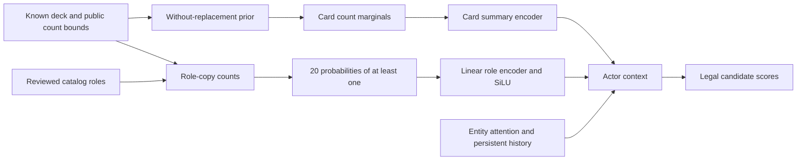

# Statistical roles: implemented default

Implemented and validated on 12 October 2026. This change implements the [research proposal](statistical-belief-and-card-roles.md) as a deliberately small first variant: deterministic hand-count statistics, reviewed overlapping roles, card identity, and recurrent history. It does not implement learned history corrections or context-dependent affordability/target queries.

## Architecture



The default is `ModelConfig.belief_mode = statistical_roles`. There is no trainable `belief_head` and no count DP in this path. `statistics.py` calculates hypergeometric card marginals and role presence from public counts. Computation is vectorized across cards and roles, in float64 for combinatorial arithmetic followed by float32 features. An empty pool/hand, known cards, zero-capacity padding, infeasible bounds, and large public pools are handled explicitly.

Each role supplies **one actor input: probability of holding at least one qualifying card**. A linear 20-to-256 encoder with SiLU adds its result to the existing card-summary vector. Expected role counts are returned for inspection but do not add another actor input. The existing card summaries retain learned card embeddings, expected card counts, card-presence probabilities, and uncertainty. Entity attention, the event GRU, decision GRU, action scorer, and critics remain in place.

Let `l_i` be known hand copies and `u_i` publicly remaining copies, including those known copies. Unknown pool counts are `r_i = u_i - l_i`, pool size `N = sum(r_i)`, and unknown hand slots `m = hand_size - sum(l_i)`. For a role with `R` qualifying unknown copies and no known qualifying card:

```text
P(holding at least one) = 1 - choose(N - R, m) / choose(N, m)
```

If a known hand card supplies the role, presence is one. Overlapping roles reuse physical cards across categories, but count a copy only once within a category. The implementation computes a union of qualifying copies; it never sums per-card presence probabilities or normalizes roles with a softmax.

For example, four counterspell copies among 40 unknown cards and five unknown hand slots produce presence 0.4271, not 0.10. Twenty land-access copies produce 0.9764. These are prior probabilities under exchangeable sampling, not exact posteriors conditioned on strategic retention, selection, and mulligans. History remains in the actor for those patterns.

## Role metadata and coverage

The 20 stable role names are defined in `src/magezero/policy/roles.py`. Catalog format v2 adds these names in fixed order plus reviewed role labels on every card. `configs/card-roles.json` records 18 reviewed entries with local XMage source references and notes, covering every card in the 10-kind simplegreen pool and several interaction examples.

Annotations preserve identities and IDs, but change the catalog digest. Unknown annotations fail explicitly rather than interpreting an unreviewed card as lacking every capability. `scripts/annotate_policy_catalog.py` converts an engine-exported v1 catalog to v2 and refuses to overwrite an existing output.

Some subtle distinctions are intentional: ward on Hulking Raptor is not labelled as a counterspell/protection card for other objects; deathtouch on Ichorspit Basilisk is not an independent removal spell; an ordinary Forest is land access rather than extra mana acceleration. A conditional future capability such as Flourishing Bloom-Kin's search is labelled but is not presented as immediately usable from hand. Negate's broad counter role does not imply it answers a creature spell.

The role layer currently describes possession of capabilities. It does **not** claim mana affordability, timing permission, legal targets, independent availability of multiple modal effects, or combo completion. Those require additional descriptors/queries and controlled evidence that they help. Generated/stolen cards, richer reveal tracking, and other pre-existing engine limitations are unchanged.

## Learning and compatibility

PPO still trains the policy and the two value estimators. The statistical prior has no trainable parameters. Its hand NLL is a diagnostic only; the learner forces the effective belief-loss coefficient to zero for `statistical_roles`, even if an old training config requests a nonzero coefficient. True hand labels remain absent from `/act` inputs, and are used only after collection for the privileged critic and evaluation.

Checkpoint format v3 explicitly identifies `entity_statistical_roles_recurrent_policy`. V2 learned-belief checkpoints retain their original architecture; loading a file that predates `belief_mode` explicitly selects `learned`. Strict state-dict loading and catalog digest checks remain enabled. Old on-policy trajectories are not converted into fresh data for a different actor.

CLI training/self-play now default to CPU because the current serial implementation measured faster there on this machine. Explicit `--device cuda` remains supported. This is a practical device choice, not a claim that GPUs are intrinsically worse for RL.

## Validation and measured speed

All **19 pytest checks passed**, including exhaustive small-pool comparisons, equality with the previous count-DP prior, overlapping role unions, known/empty hands, deck reordering and batch padding, role metadata validation, service retries, CPU/CUDA PPO gradients, statistical checkpoint reloads, and old v2 compatibility.

[Aggregate validation data](statistical-roles-validation.json) records the smoke run and benchmarks. Actual checkpoint comparison confirmed nonzero changes in both the role encoder and action scorer, while category probabilities for the same public observation remained identical after training. The previous five-update pilot checkpoint also loaded successfully as `learned` mode.

The existing rebuilt XMage distribution completed two normal simplegreen mirror games with the new model. Four complete player trajectories contained **1,223 decisions**. A CPU PPO update trained the role encoder and policy, and saved `artifacts/statistical-roles-smoke/generation_0000/policy.pt`. Collection took 30.95 seconds, learning 23.98 seconds, and the full generation 55.20 seconds. This is integration evidence, not evidence of playing-strength improvement. The belief NLL remains a statistical diagnostic; it should not be interpreted as a learned-head loss.

The matched synthetic forward benchmark used width 256, two attention layers, 64 entities, 32 actions, 24 deck kinds, hand size seven, batch one, one CPU thread, and 50 warmed timed samples:

| Device | Learned-count model median | Statistical-role model median |
|---|---:|---:|
| CPU | 7.29 ms | 4.72 ms |
| CUDA / RTX 5070 | 66.97 ms | 20.54 ms |

The statistical model's CPU median was approximately 35% lower for this workload. Actor parameter count at 24 kinds fell from 4,344,387 to 4,200,962. Timings exclude HTTP, encoding, Java, and learning; CUDA p95 varied substantially. Raw data: `artifacts/statistical-roles-benchmark.json`.

A separate matched learner-device test used the same complete 283-decision episode and initial statistical checkpoint, one PPO epoch and sequence length 32. CPU took **6.52 seconds** versus **27.04 seconds** on CUDA, including target replay, backward, load and save. This one-episode result informed the CPU CLI default. Raw data: `artifacts/statistical-roles-learner-profile/report.json`.

## Reproduction

Use fresh artifact paths:

```powershell
.venv/Scripts/python.exe scripts/annotate_policy_catalog.py --catalog artifacts/real-card-catalog.json --annotations configs/card-roles.json --output artifacts/roles-catalog-new.json
.venv/Scripts/mz.exe init --catalog artifacts/roles-catalog-new.json --config configs/policy.yml --output artifacts/roles-initial-new.pt --seed 20261012
.venv/Scripts/mz.exe selfplay --checkpoint artifacts/roles-initial-new.pt --game configs/real-card-smoke.yml --config configs/policy-statistical-smoke.yml --engine-script xmage/mz-policy.bat --output artifacts/roles-run-new --iterations 1 --games 2 --actor-device cpu --device cpu
.venv/Scripts/python.exe scripts/benchmark_statistical_roles.py --output artifacts/roles-benchmark-new.json
```

The initial checkpoint already created here is `artifacts/statistical-roles-initial.pt`; the smoke-trained checkpoint above has one update. New deck pools need reviewed annotations for their entire catalog. Use fresh seeds and multiple relevant matchups for a strength comparison, including counters/removal/tricks; simplegreen alone cannot establish benefit for those categories.
